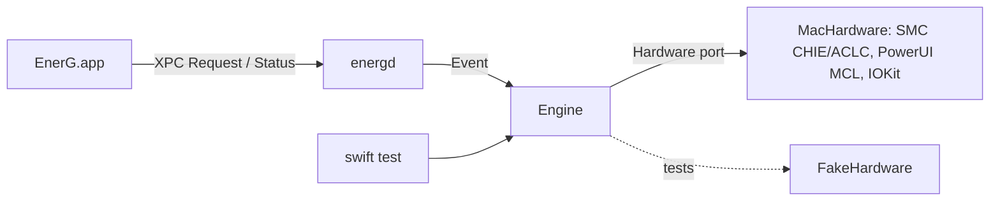

# EnerG — Design

Date: 2026-10-20
Status: approved (brainstorming)
Glossary: [CONTEXT.md](../../../CONTEXT.md)

## Purpose

EnerG is a menu bar app that keeps a MacBook from charging above a **Charge Limit**. At the limit, the Mac runs from the adapter instead of cycling the battery. It is an open-source alternative to AlDente, scoped to the features its author uses:

- Charge Limit
- Discharge and Auto-Discharge
- MagSafe LED control
- Top Up
- Pause
- Power/adapter feedback

## Scope

- **Hardware:** Apple Silicon running firmware that gates the SMC charge-inhibit keys (firmware ≥ 20457.0.125, as shipped with macOS 27 and the 26.7/15.8 security updates). The reference machine is a Mac17,8 (M5 Pro), macOS 27.0.1, firmware 20457.1.29.
- **Not in scope:**
  - Intel Macs.
  - Legacy SMC inhibit keys (`CH0B`/`CH0C`/`CHTE`). The Hardware port makes it possible to add them later.
  - Sailing as a setting (see below).
  - Heat protection, calibration, schedules, history graphs, a CLI.
- **License:** undecided. No LICENSE file yet. The code is written clean-room: no AlDente code is copied, only publicly documented key facts.

## Verified platform facts (probe, 2026-10-20)

| Mechanism | Used for | Root? | Verified |
|---|---|---|---|
| PowerUI `PowerUISmartChargeClient` `setMCLLimit:error:` / `getMCLLimitWithError:` / `disableMCL:` / `enableMCL:` (private framework, loaded with dlopen) | **Charge Limit** (80/85/90/95/100) | yes for writes | `setMCLLimit(85)` → ok, SMC `CHLT` `500500`→`550500` |
| SMC `CHIE` (hex_, 1 byte): `00` = adapter on, `08` = adapter off | **Discharge** | yes | Adapter off → "Battery Power"; back on → "AC Power" |
| SMC `ACLC` (ui8): `00` = system, `01` = off, `03` = green, `04` = orange, `06` = slow blink, `07` = fast blink | **LED Mode** | yes | LED changed visibly; value survived a plug-state change |
| SMC `AC-W` (si8): `04` = charger physically plugged in, `FF` (-1) = unplugged; unprivileged read | `BatterySnapshot.adapterConnected` | no | Stays `04` with `CHIE`=`08` and in the stuck state below |
| IOKit `AppleSmartBattery` registry (`CurrentCapacity`, `IsCharging`, `ExternalConnected`, `InstantAmperage`, `Voltage`, `AdapterDetails`) | Battery snapshot | no | read OK |

Notes:

- **SMC read lag:** a read issued straight after an SMC write returns the previous value. A later read returns the new one.
- **No charge inhibit:** `CH0B`, `CH0C`, `CHTE` and `CH0I` do not exist on this firmware. `bfF0`, `bfD0`, `bfE0` and `CH0J` return `kIOReturnNotPrivileged`, even for root.
- **Native recharge band:** `CHLT` = `[limit, 0x05, 0x00]`. The middle byte is very likely a fixed 5% recharge band. EnerG therefore offers no Sailing setting.
- **Adapter state is hidden while discharging:** with `CHIE`=`08`, `ExternalConnected` reads `No`. `AC-W` is the physical-presence signal (2026-10-20, Mac17,8): `BatterySnapshot.adapterConnected` reads it and falls back to `ExternalConnected` only if `AC-W` can't be read.
- **Native-limit stuck state:** turning the adapter back on (`CHIE` `08`→`00`) while the battery is **above** the native limit leaves macOS on "Battery Power" (`ExternalConnected` = No) for 26 s+, until the native limit is disabled. Below the limit, AC returns within 1 s. Disabling the native limit and setting it again restores AC at once, and AC then holds at the limit.
- **USB-C charging:** `CHIE`=`08` cuts USB-C input too, on either port. macOS then shows "Battery Power" and `ExternalConnected` = No. `AC-W` stays > 0 while it is cut.
- **USB-C and MagSafe both attached:** `CHIE` cuts both inputs. `AC-W` stays > 0 while any charger is attached, and goes to -1 at once when the last one is unplugged. `AdapterDetails.Watts` reports whichever input macOS picked, and changes when one is pulled.
- **LED without MagSafe:** `ACLC` writes succeed with USB-C only, with no visible effect. So there is no false "LED unavailable".
- **Registry cadence:** the `AppleSmartBattery` registry refreshes about every 60 s (`UpdateTime`), on AC and on battery. The 2026-10-20 probe saw `UpdateTime` lag 50 s on AC too. While `CHIE` cuts the adapter, `InstantAmperage` keeps the last pre-cut value for up to a minute. `PSTR` (SMC) is live.
- **Live battery power:** `B0AC` (si16 mA) and `B0AV` (ui16 mV), little-endian, are readable unprivileged and live. Their product tracks `PSTR` while cut. `PPBR` isn't battery power.

## Behaviour

| Situation | Native limit | Adapter (`CHIE`) | LED (Auto mode) | Sleep assertion |
|---|---|---|---|---|
| Below limit, charging | limit | on | orange | none |
| At limit | limit | on | green | none |
| Above limit, Auto-Discharge on | limit | **off** until % ≤ limit | off | prevent idle sleep |
| Manual Discharge to target T | limit | **off** until % ≤ T | off | prevent idle sleep |
| Top Up | disabled | on | orange, then green at 100 | none |
| Paused | disabled | on | system (`00`) | none |
| On battery (physically unplugged, `AC-W`) | limit | on | system | none |

Rules:

- **Discharge Target:** defaults to the Charge Limit. It can be below 80. A manual Discharge replaces any Auto-Discharge in progress.
- **When a Discharge ends:** on reaching the target, on `willSleep`, on lid close, on cancel, when every charger is unplugged (only when plug presence comes from `AC-W`), and on daemon restart. A manual Discharge is not persisted across a restart. Auto-Discharge simply re-triggers if the battery is still above the limit.
- **Native-limit unstick:** when the Engine turns the adapter on and its prior state is cut or unknown (start, wake), and the battery is above a set native limit, it writes the limit as disabled and then sets it again, right after adapter-on (see the stuck state above). Not on daemon stop, and not when the desired limit is disabled (Top Up, Pause, 100).
- **Sleep:** the `willSleep` handler turns the adapter on before it acknowledges the power change. The native limit persists through sleep on its own.
- **Top Up:** can be stopped early (`cancelTopUp`). It cancels any Discharge, so the adapter is on and `ExternalConnected` is reliable. It ends on unplug, and the limit is restored. On the next plug-in at >limit with Auto-Discharge on, a Discharge starts. This is intended.
- **Pause:** restores stock behaviour fully. Native limit disabled, adapter on, LED `00`, no sleep assertion. The daemon keeps running, and Resume re-applies everything.
- **Release** (sent before uninstall): acts exactly like Pause, but only for the running daemon. It is not persisted, so a reinstall starts with the user's real settings. `setPaused` or a daemon restart ends it.
- **LED modes:**
  - Auto: the table above.
  - Off: `01` while plugged in and not paused. When unplugged, the LED is handed back to the system (`00`); it is dark anyway.
  - Blink: like Auto, but `06` instead of off during a Discharge.
- **Weak Adapter:** the adapter is connected and EnerG isn't discharging, yet the battery current is negative for 2 consecutive ticks (30 s apart); the first tick after a Discharge ends doesn't count. It shows as a warning only and does not change behaviour.
- **Warnings in Status:** Weak Adapter, AlDente running (the app or its helper `com.apphousekitchen.aldente-pro.helper`; detected by the app, shown but not blocking), battery unreadable, and a feature unavailable because its hardware write failed.
- **Wake:** `didWake` re-asserts the full state. A write that fails during this re-assert doesn't mark the feature unavailable; the next event re-asserts everything again.
- **Daemon start:** writes `CHIE`=`00` first, then re-applies the full state.
- **Daemon stop (SIGTERM):** ends any Discharge, writes `CHIE`=`00`, hands the LED to the system and releases the sleep assertion. The native limit and settings are left as they are, because a restart can't be told apart from an uninstall.

## Architecture

The app, the daemon, and the core package are three modules that share one XPC contract. All policy logic lives behind a single Engine interface. That interface is tested through a fake Hardware adapter.

| Module | Interface | Seam | Depth rationale | Test surface |
|---|---|---|---|---|
| **Engine** (`EnerGCore`) | `init(hardware:, settings:)`; `handle(_ event: Event) -> Status`, synchronous; `settings` (get/set). `Event` ∈ `.start`, `.tick`, `.powerChanged`, `.willSleep`, `.didWake`, `.lid(closed:)`, `.command(Request)`, `.stop` (daemon shutdown: adapter on, LED to system, sleep assertion released; never touches the native limit or settings). **Invariants:** `.start` writes adapter-on before anything else; `.willSleep` returns only after adapter-on has been applied; writes happen only on change (diffed against the last applied **Actuation**). | Its own interface. **Policy** is an internal seam: a pure `(Settings, BatterySnapshot, Session) → Actuation`, not exported. | Deep: holds every rule in Behaviour. Callers only feed it events. | Event-sequence tests against `FakeHardware`, asserting the recorded writes. |
| **Hardware** port (`EnerGCore`) | `snapshot() throws -> BatterySnapshot` (percent, isCharging, adapterConnected = charger physically plugged in, from `AC-W`, plugSensed = adapterConnected came from `AC-W`, adapterWatts, batteryWatts from `B0AC`×`B0AV` with a registry fallback, systemWatts); `setChargeLimit(Int?) throws` (nil = native limit disabled); `setAdapter(enabled:) throws`; `setLED(LEDState) throws`; `setPreventSleep(Bool)`. Throws `HardwareError` (`.notPrivileged`, `.keyMissing`, `.frameworkUnavailable`, `.io(code)`). | Protocol. Two adapters: `MacHardware` (in energd) and `FakeHardware` (tests). Dependency category: true external → mock. | Hides SMC struct layout and the read lag, PowerUI dlopen and objc_msgSend, and IOKit registry parsing. Internal seams: `SMCClient`, `PowerUIClient`, `BatteryReader`. | `FakeHardware` in unit tests. `MacHardware` only via the on-device `scripts/smoke.sh`. |
| **Protocol** (`EnerGCore`) | Codable `Request` ∈ `getStatus`, `setLimit(Int)`, `discharge(to: Int)`, `cancelDischarge`, `topUp`, `cancelTopUp`, `setLEDMode(LEDMode)`, `setAutoDischarge(Bool)`, `setPaused(Bool)`, `release` (Pause without persisting it). Every request is answered with `Status` (state, settings, snapshot with percent and power flows, dischargeTarget, `toppingUp`, warnings). `toppingUp` reports an active Top Up even when `state` shows something else, e.g. `.unknown`. | The XPC contract between EnerG.app and energd. | Shallow on purpose: it is a data contract with one reply shape. | Codable round-trip tests. |
| **energd** (daemon target) | launchd mach service `app.energ.energd` (app bundle ID `app.energ.EnerG`), registered with `SMAppService.daemon`, KeepAlive. Composition root: <br>• `XPCListener` with a peer code-signing requirement (same Team ID, signing identifier `app.energ.EnerG`) <br>• IOPS power notifications, `IORegisterForSystemPower` (sleep/wake), clamshell state → `engine.handle` <br>• a 30 s tick while a Discharge or Top Up is active <br>• settings JSON at `/Library/Application Support/EnerG/settings.json` | Leaf. | Thin: wiring only. Deletion test: removing it pushes no logic anywhere, because the logic lives in the Engine. | Manual / smoke. |
| **EnerG.app** (UI target) | SwiftUI `MenuBarExtra` popover; `DaemonClient` (async `send(Request) -> Status`, polls every 2 s only while the popover is open); `HelperInstaller` (register, approval prompt, unregister; launch at login via `SMAppService.mainApp`); AlDente detection. | Leaf. | Thin: rendering and the install flow. | SwiftUI previews with a stubbed `Status`. |



### Data flow

- **User actions:** a UI action → `Request` over XPC → energd → `engine.handle(.command(…))` → Policy computes an Actuation → the Engine diffs it against the last applied one and writes changes through Hardware → `Status` is returned.
- **System events:** they follow the same path, entering as `Event`s.
- **Settings:** the daemon is the single source of truth. It persists settings after each command. The app holds no state.

### Popover UI

Control Center–style tiles. The layout was chosen with a throwaway SwiftUI prototype on 2026-10-20: the variant "C — Control Center tiles", with the adjustments below. From top to bottom, 340 pt wide:

1. **Battery tile:** large %, state label, and a Charge Limit slider that snaps to 80/85/90/95/100. The limit is sent once, when the drag ends.
2. **Notice tiles** (text wraps): Weak Adapter, unavailable features, battery unreadable, AlDente running, and helper errors. These sit **between** the Charge Limit and the controls. When the helper is not installed or needs approval, only a helper tile (Install / Open Login Items) and the footer are shown.
3. **Control grid:** 2 × 3 toggle tiles. A tile is highlighted when on, and every click toggles it.
   - **Discharge:** when idle, a click opens a popover with a target slider (5–100, step 5) and Start. The target defaults to min(limit, current % − 5), rounded down to a multiple of 5 and clamped to 5–100. Start is greyed out, with the hint "Pick a target below the current %", while the target is at or above the current %. While running, the tile shows "To X% · click stop" and a click cancels. No inline cancel area.
   - **Auto-Discharge:** on/off.
   - **Top Up:** a click starts it; while running, a click stops it (`cancelTopUp`).
   - **Pause:** on/off.
   - **MagSafe LED:** a click cycles Auto → Off → Blink on discharge.
   - **Launch at Login:** on/off.
4. **Power-flow tile:** Adapter (W / "Cut by EnerG" / "Unplugged") → Mac (system W) ↔ Battery (±W). The arrows dim when no power flows.
5. **Footer:** Uninstall Helper, Quit EnerG.

### Error handling

- **A hardware write fails:** the Engine marks that feature unavailable in `Status.warnings`, stops retrying until the next `.start`, and the UI disables the control. Exceptions: adapter-on is never marked unavailable and is retried; a failure during the wake re-assert is retried on the next event. The daemon never crashes because of a hardware error.
- **The native limit fails:** Discharge and LED keep working.
- **The daemon is not registered or needs approval:** the app shows a banner with a button that opens Login Items settings.
- **The XPC peer fails the code-signing requirement:** the connection is rejected.
- **The daemon exits unexpectedly:** launchd restarts it, and `.start` resets the adapter.
- **Uninstall:** `release` (like Pause, not persisted), then `SMAppService.daemon.unregister()`. If `release` fails, the helper is not unregistered; the app shows the error and offers **Uninstall Anyway**, which unregisters without `release`. If energd is still running, its SIGTERM stop restores the adapter and LED; if not, they may stay as last set. The native limit may stay on. Uninstall leaves `settings.json` in place, so a reinstall restores the settings.
- **Login Items toggle:** switching EnerG off there stops energd (SIGTERM): adapter and LED are restored, the native limit stays at its last value.
- **energd can't register for sleep/wake or lid events:** it logs a fault, stops the Engine and exits 1; launchd relaunches it.

## Testing

- `swift test` on `EnerGCore`, written TDD:
  - Engine event-sequence tests against `FakeHardware`, covering every row and rule in Behaviour, including the write ordering on `.start` and `.willSleep` and idempotence (no duplicate writes).
  - Protocol Codable round-trips.
- `scripts/smoke.sh` (run as root, manually) exercises `MacHardware` on the device and restores state on exit.
- No UI tests in v1.

## Build and project layout

```
energ/
├── project.yml               # XcodeGen; EnerG.xcodeproj is gitignored
├── Packages/EnerGKit/        # Swift package
│   ├── EnerGCore/            #   Engine, Policy, Hardware port, Protocol, SettingsStore (+ tests with FakeHardware)
│   ├── EnerGMac/             #   MacHardware (SMC, PowerUI, IOKit)
│   ├── CPlatform/            #   C shims for SMC and PowerUI
│   └── energ-smoke/          #   on-device hardware check
├── EnerG/                    # app target
├── energd/                   # daemon target, launchd plist
├── scripts/                  # install.sh, smoke.sh
└── CONTEXT.md
```

- **Signing:** a free Apple ID "Apple Development" certificate. Developer ID and notarization are deferred until the first public release.
- **Targets:** macOS 27, Swift 6 language mode, Xcode 27.1, XcodeGen 2.46.

## Spikes (first plan steps)

1. **Signing:** confirm that `SMAppService.daemon` registers and launches a daemon embedded in an app signed with the free Apple Development certificate, and that root writes to `CHIE`/`ACLC` and `setMCLLimit` work from that daemon.
2. **Physical adapter presence while `CHIE`=`08`:** resolved by the on-device E2E run: `AC-W` (see Verified platform facts).
3. **5% native band:** log % and charging state passively at the limit with AlDente fully stopped. This confirms that Sailing is not needed. The outcome only affects documentation.

## Changes during planning (2026-10-20)

See the "Deviations from spec" section of `docs/superpowers/plans/2026-10-20-energ.md`. In short:
- The package is `EnerGKit`, with `EnerGCore` and `EnerGMac`; `MacHardware` lives in the package.
- Spikes 2 and 3 are dropped.
- The Optimized Charging warning is dropped.
- `.lidClosed` becomes `.lid(closed:)`. No Discharge starts while asleep or with the lid closed.
- The tick runs every 30 s unconditionally.
